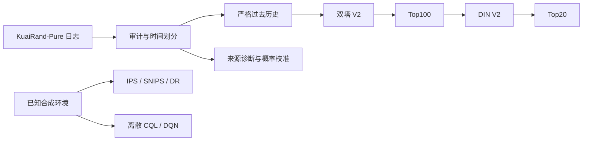

# 项目结构与模块职责

正式推荐链路：严格过去的标准正反馈历史 → 双塔 V2 → Top100 → DIN V2 → Top20。当前主种子为 42，视频向量 32 维，历史最长 50；召回目录为 7,538 个训练已知视频。

| 目录 | 职责 | 在首版中的地位 |
| --- | --- | --- |
| `src/data/` | 下载校验、审计、日历划分、严格历史 | 数据协议 |
| `src/retrieval/` | 热门度、ItemCF、初版双塔、全目录评测 | 基线与共用组件 |
| `src/retrieval_v2/` | 全目录选择损失、历史残差双塔 | 正式召回 |
| `src/ranking/` | 真实曝光 DIN/LR 适配与早期对照 | 历史对照 |
| `src/ranking_v2/` | 基础召回分数加残差精排、曝光辅助损失 | 正式精排 |
| `src/ranking_v3/`、`src/ranking_v3_frozen/` | 固定候选的结构优化实验 | 未采用的实验 |
| `src/sequential/` | RecBole SASRec、全目录与固定池评测 | 独立对照 |
| `src/exposure/` | 真实来源诊断、校准；合成单动作 OPE | 区分观察与合成 |
| `src/offline_rl/` | 已知有限 MDP、CQL/DQN、精确与采样评估 | 独立合成策略实验 |
| `src/system_evaluation/` | 跨模块汇总、候选漏斗、冻结推荐接口 | 需要本地实验资产 |
| `configs/`、`tests/`、`scripts/` | 配置、边界测试、训练与交付入口 | 公开源码 |
| `reports/` | 选取的聚合报告和历史验收记录 | 历史证据快照 |
| `results/v0.1.0/` | 首版结果摘要与证据摘要哈希 | 公开版本结果 |

`FrozenPipeline.recommend(users, tabs, history)` 接收编码后的用户、场景和严格过去历史。返回候选 ID/分数和最终 Top20。它需要冻结的词表和检查点，不能直接在仅含源码的克隆中推理。当前响应重放限定检索 batch512、精排 batch256；其他批形不承诺逐位相同。

本机工作区还有 `.runtime/`、数据、模型、完整实验、阶段计划及旧代码副本；这些均不属于首版提交范围。整理没有移动或重写冻结路径。后续长尾优化另建实验，不覆盖 V2。
