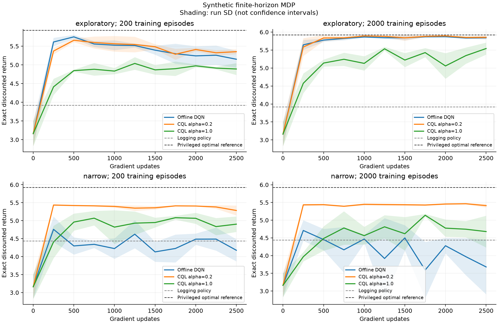
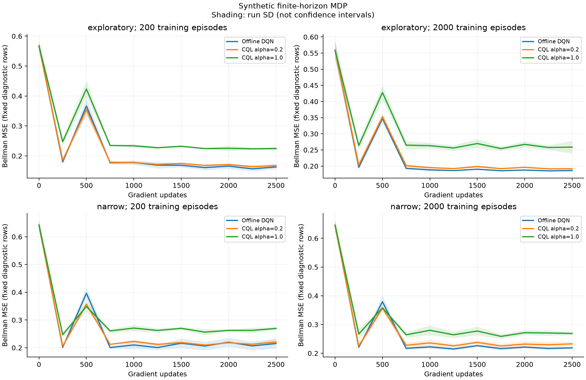

# CQL离线策略优化：实际实验报告

**本模块评价已知有限模拟环境中的累计奖励，不代表KuaiRand真实RL、真实用户收益或Top20改善。**

运行预算：完整预定义实验。
环境为4类兴趣×3级疲劳，共12个完全可观测状态、8个动作、10步会话，折扣gamma=0.95。兴趣/疲劳为人为定义的模拟状态，没有从真实用户日志拟合。

## 实现与真实数据适用性

- KuaiRand-Pure缺失池外交互，当前没有完整状态转移证据；不把相邻日志当作已验证真实MDP。
- 本机Pearl可导入路径是否存在：False。已核对其官方DeepQLearning、保守损失和依赖声明；没有进行Pearl运行兼容性验收，也未安装Gym/MuJoCo等新依赖。
- 本项目使用现有PyTorch独立实现离散CQL(H)，不是Pearl运行结果或论文基准复现。
- 损失为MSE Bellman项＋alpha×mean(logsumexp(Q(s,:))−Q(s,a_logged))，温度1；目标网络无梯度，有限时域最后一步不bootstrap。
- t与state共同输入网络。训练只读离线记录，完整奖励/转移表只用于生成和评估。

## 预定义训练协议

- 日志机制=['exploratory', 'narrow']；每次训练会话数=[200, 2000]；独立验证会话数=300；种子=[42, 43, 44]。
- exploratory对所有动作有正概率；narrow每个状态只支持两个动作，其余是真实零支持。二者都从固定模拟器生成完整会话。
- 所有模型共享同条件日志、初始化、batch序列与训练预算；alpha=[0.0, 0.2, 1.0]，主CQL alpha预先固定为0.2。
- MLP隐藏层=[64, 64]；学习率=0.001；batch=256；固定2500次更新，目标网络每100步硬同步。
- 固定最后检查点，未按验证或评估奖励选择轮次/alpha；训练完成后才从保存Q快照计算奖励曲线。训练损失曲线使用前2048条固定诊断记录，验证Bellman指标用完整验证日志。

## 策略价值与覆盖结果

回报是每个策略在完整已知模拟器中的精确有限时域期望，由反向DP和前向占用交叉核对。随机/日志行为/经验行为克隆是可用基线；myopic_oracle和optimal_oracle具有真实奖励/转移特权，仅作参考。数值越高表示当前模拟目标下累计正反馈越多。

| 日志 | 训练会话 | 策略 | 精确折扣回报均值 | 跨运行SD | 相对DQN配对差均值 | 零支持动作占用 | 训练未见动作占用 |
| --- | ---: | --- | ---: | ---: | ---: | ---: | ---: |
| exploratory | 200 | uniform | 2.64563 | 0.00000 | -2.50529 | 0.00000 | 0.15701 |
| exploratory | 200 | logging_policy | 3.91954 | 0.00000 | -1.23139 | 0.00000 | 0.10914 |
| exploratory | 200 | empirical_bc | 3.89140 | 0.07708 | -1.25953 | 0.00000 | 0.00064 |
| exploratory | 200 | myopic_oracle | 5.90920 | 0.00000 | 0.75828 | 0.00000 | 0.12271 |
| exploratory | 200 | optimal_oracle | 5.92435 | 0.00000 | 0.77342 | 0.00000 | 0.12337 |
| exploratory | 200 | offline_dqn | 5.15092 | 0.22685 | 0.00000 | 0.00000 | 0.10314 |
| exploratory | 200 | cql_alpha0.2 | 5.35288 | 0.06598 | 0.20196 | 0.00000 | 0.03369 |
| exploratory | 200 | cql_alpha1.0 | 4.88989 | 0.15920 | -0.26104 | 0.00000 | 0.00092 |
| exploratory | 2000 | uniform | 2.64563 | 0.00000 | -3.19597 | 0.00000 | 0.00094 |
| exploratory | 2000 | logging_policy | 3.91954 | 0.00000 | -1.92206 | 0.00000 | 0.00103 |
| exploratory | 2000 | empirical_bc | 3.91549 | 0.01423 | -1.92611 | 0.00000 | 0.00000 |
| exploratory | 2000 | myopic_oracle | 5.90920 | 0.00000 | 0.06760 | 0.00000 | 0.00000 |
| exploratory | 2000 | optimal_oracle | 5.92435 | 0.00000 | 0.08275 | 0.00000 | 0.00000 |
| exploratory | 2000 | offline_dqn | 5.84160 | 0.04418 | 0.00000 | 0.00000 | 0.00000 |
| exploratory | 2000 | cql_alpha0.2 | 5.85343 | 0.04589 | 0.01183 | 0.00000 | 0.00000 |
| exploratory | 2000 | cql_alpha1.0 | 5.54181 | 0.16660 | -0.29979 | 0.00000 | 0.00000 |
| narrow | 200 | uniform | 2.64563 | 0.00000 | -1.53082 | 0.75000 | 0.76037 |
| narrow | 200 | logging_policy | 4.43780 | 0.00000 | 0.26135 | 0.00000 | 0.00665 |
| narrow | 200 | empirical_bc | 4.46383 | 0.02881 | 0.28738 | 0.00000 | 0.00000 |
| narrow | 200 | myopic_oracle | 5.90920 | 0.00000 | 1.73275 | 0.23571 | 0.23571 |
| narrow | 200 | optimal_oracle | 5.92435 | 0.00000 | 1.74790 | 0.23968 | 0.24849 |
| narrow | 200 | offline_dqn | 4.17645 | 0.30820 | 0.00000 | 0.35139 | 0.37667 |
| narrow | 200 | cql_alpha0.2 | 5.28369 | 0.13804 | 1.10724 | 0.00000 | 0.00117 |
| narrow | 200 | cql_alpha1.0 | 4.90295 | 0.21512 | 0.72650 | 0.00000 | 0.00135 |
| narrow | 2000 | uniform | 2.64563 | 0.00000 | -1.03469 | 0.75000 | 0.75000 |
| narrow | 2000 | logging_policy | 4.43780 | 0.00000 | 0.75748 | 0.00000 | 0.00000 |
| narrow | 2000 | empirical_bc | 4.44146 | 0.00618 | 0.76113 | 0.00000 | 0.00000 |
| narrow | 2000 | myopic_oracle | 5.90920 | 0.00000 | 2.22888 | 0.23571 | 0.23571 |
| narrow | 2000 | optimal_oracle | 5.92435 | 0.00000 | 2.24402 | 0.23968 | 0.23968 |
| narrow | 2000 | offline_dqn | 3.68033 | 0.77383 | 0.00000 | 0.46291 | 0.46291 |
| narrow | 2000 | cql_alpha0.2 | 5.41089 | 0.05222 | 1.73057 | 0.00000 | 0.00000 |
| narrow | 2000 | cql_alpha1.0 | 4.67883 | 0.44869 | 0.99850 | 0.00000 | 0.00000 |

跨运行变化同时包括离线日志与网络初始化变化；CQL/DQN差值在相同种子的同一日志上配对。运行次数有限，不将样本SD当作高精度显著性证明。

## 预定义主模型的实际对照

- exploratory、200条训练会话：主CQL平均回报5.35288，DQN为5.15092，日志策略为3.91954；主CQL减DQN=0.20196。
- exploratory、2000条训练会话：主CQL平均回报5.85343，DQN为5.84160，日志策略为3.91954；主CQL减DQN=0.01183。
- narrow、200条训练会话：主CQL平均回报5.28369，DQN为4.17645，日志策略为4.43780；主CQL减DQN=1.10724。
- narrow、2000条训练会话：主CQL平均回报5.41089，DQN为3.68033，日志策略为4.43780；主CQL减DQN=1.73057。

以上对照按预定义主模型汇报，未从alpha敏感性表中事后挑选胜出配置。

## Q值诊断

Q偏差为模型预测的初始策略价值减该策略的精确真实价值。负值表示在此定义下低估，不自动证明理论下界；也不保证回报更高。

| 日志 | 训练会话 | 学习模型 | 平均初始Q偏差 |
| --- | ---: | --- | ---: |
| exploratory | 200 | offline_dqn | 1.99809 |
| exploratory | 200 | cql_alpha0.2 | 1.30065 |
| exploratory | 200 | cql_alpha1.0 | 1.71761 |
| exploratory | 2000 | offline_dqn | 0.18882 |
| exploratory | 2000 | cql_alpha0.2 | 0.21498 |
| exploratory | 2000 | cql_alpha1.0 | 0.93399 |
| narrow | 200 | offline_dqn | 2.92027 |
| narrow | 200 | cql_alpha0.2 | 0.46664 |
| narrow | 200 | cql_alpha1.0 | 0.31169 |
| narrow | 2000 | offline_dqn | 2.62064 |
| narrow | 2000 | cql_alpha0.2 | 0.04170 |
| narrow | 2000 | cql_alpha1.0 | 0.33796 |

## 独立会话模拟与不确定性

每策略另用5000条独立会话模拟回报，使用500次整会话bootstrap。相同条件策略共享随机数构成配对；区间条件于固定训练后策略，不包含重新训练的不确定性。全部均值/区间、相对日志/BC/DQN配对差保存在完整JSON。
精确DP价值不依赖Monte Carlo置信区间；程序用6个标准误加0.03的诊断阈值核对采样与精确值，并不要求所有名义95%区间都包含真值。

## 曲线

奖励曲线为保存Q快照对应策略的精确值；阴影为跨运行样本SD，不是置信区间。验证与训练损失不直接等于策略回报。





## 核验和复现

- 重算PASS：12个日志条件，36个检查点重载，96组策略指标，396条曲线。
- 所有训练/验证轨迹按固定种子重放；完整会话边界、终止、实际行为概率与支持核对；全部策略模拟回报重放。
- 全部模型最终Q与检查点逐值一致；初始参数与batch序列重新核验；保存在线/目标Q快照重算诊断损失及全部奖励曲线；CSV与JSON逐值核对。
- 累计梯度范数是训练时记录的元数据，仅核对有限性与单调性，未逐步重放梯度；诊断样本数另作核对。
- 输出绑定配置、源码、环境、旧证据指纹和全部产物哈希，完成目录拒绝不一致复用。

```powershell
. .\scripts\enter_env.ps1
python -B -m src.offline_rl.run --phase all --output-directory experiments/offline_rl_reproduction
python -B -m src.offline_rl.run --phase verify --output-directory experiments/offline_rl_reproduction
python -B -m src.offline_rl.run --phase report --output-directory experiments/offline_rl_reproduction
```

## 结果解释的限制

- 神经CQL并不保证优于DQN、行为克隆或日志策略；所有预定义条件和退化结果均保留。
- 对日志零支持动作的真实价值来自已知模拟器；不声称仅凭离线日志可以识别其收益。
- 这不是由单动作IPS/DR推算的整会话收益，也没有将Top20列表当作一个具有已知概率的动作。
- 真实推荐主流程、真实Top20与曝光校准模块未被替换；新机器环境复现、完整真实转移与线上验收不在本轮完成范围。

## 参考

- [CQL原论文](https://arxiv.org/abs/2006.04779)。
- [Pearl DeepTDLearning](https://github.com/facebookresearch/Pearl/blob/main/pearl/policy_learners/sequential_decision_making/deep_td_learning.py)、[保守损失接口](https://github.com/facebookresearch/Pearl/blob/main/pearl/utils/functional_utils/learning/loss_fn_utils.py)、[依赖声明](https://github.com/facebookresearch/Pearl/blob/main/pyproject.toml)。
