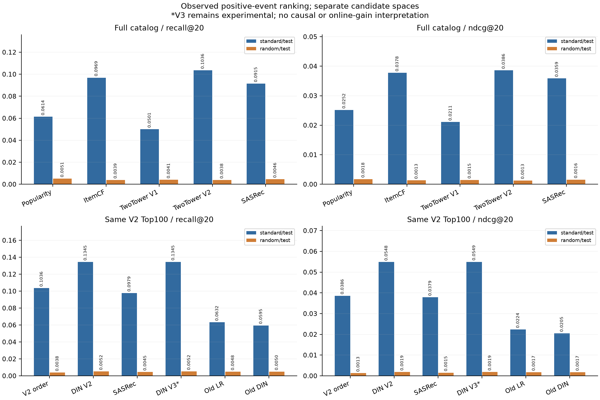
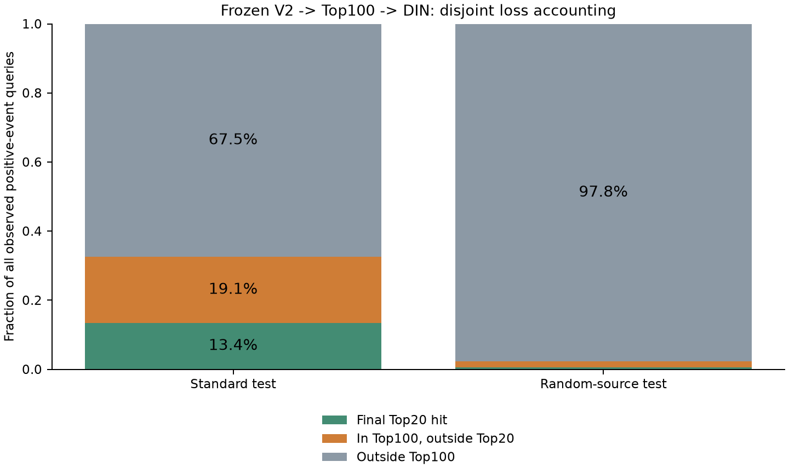

# 统一评估与整体效果诊断

**本阶段完成统一核验、真实推荐接口抽样贯通与瓶颈诊断，没有训练新模型或改变正式Top20。**

预算：正式全量排名/预测重算；曝光/RL深度重放。
当前主流程：固定双塔V2 seed42 → 同一Top100 → DIN V2 seed42 → Top20。全目录、固定池、真实反馈概率、合成OPE与合成RL分别评价，没有混合总分。
真实指标为日志观测正事件的单正目标代理；冷记录保留，测试此前已查看，属于迭代复测。

## 真实排序：同口径对照

### 全目录检索

| 来源 | 模型 | 正事件数 | Recall@20 | NDCG@20 | Recall@100 | MRR | MRR范围 |
| --- | --- | ---: | ---: | ---: | ---: | ---: | --- |
| standard/test | popularity | 75430 | 0.061355 | 0.025171 | 0.197309 | 0.019912 | full_catalog |
| standard/test | itemcf | 75430 | 0.096871 | 0.037764 | 0.302400 | 0.028250 | full_catalog |
| standard/test | two_tower_seed42 | 75430 | 0.050099 | 0.021084 | 0.116466 | 0.015713 | full_catalog |
| standard/test | two_tower_v2_seed42 | 75430 | 0.103579 | 0.038619 | 0.325109 | 0.028074 | full_catalog |
| standard/test | sasrec_seed42 | 75430 | 0.091489 | 0.035887 | 0.267294 | 0.026675 | full_catalog |
| random/test | popularity | 160735 | 0.005089 | 0.001757 | 0.020276 | 0.001878 | full_catalog |
| random/test | itemcf | 160735 | 0.003913 | 0.001330 | 0.021321 | 0.001731 | full_catalog |
| random/test | two_tower_seed42 | 160735 | 0.004050 | 0.001453 | 0.018023 | 0.001669 | full_catalog |
| random/test | two_tower_v2_seed42 | 160735 | 0.003826 | 0.001280 | 0.022298 | 0.001734 | full_catalog |
| random/test | sasrec_seed42 | 160735 | 0.004554 | 0.001563 | 0.022733 | 0.001874 | full_catalog |
### 固定同一V2 Top100排序

| 来源 | 模型 | 正事件数 | Recall@20 | NDCG@20 | Recall@100 | MRR | MRR范围 |
| --- | --- | ---: | ---: | ---: | ---: | ---: | --- |
| standard/test | v2_original_order | 75430 | 0.103579 | 0.038619 | 0.325109 | 0.025971 | 100 |
| standard/test | din_v2_seed42 | 75430 | 0.134482 | 0.054840 | 0.325109 | 0.037722 | 100 |
| standard/test | sasrec_seed42 | 75430 | 0.097852 | 0.037900 | 0.325109 | 0.026526 | 100 |
| standard/test | din_v3_experimental_seed42（实验，未采用） | 75430 | 0.134549 | 0.054937 | 0.325109 | 0.037827 | 100 |
| standard/test | old_lr | 75430 | 0.063237 | 0.022360 | 0.325109 | 0.016739 | 100 |
| standard/test | old_din_seed42 | 75430 | 0.059499 | 0.020518 | 0.325109 | 0.015543 | 100 |
| random/test | v2_original_order | 160735 | 0.003826 | 0.001280 | 0.022298 | 0.000971 | 100 |
| random/test | din_v2_seed42 | 160735 | 0.005164 | 0.001856 | 0.022298 | 0.001355 | 100 |
| random/test | sasrec_seed42 | 160735 | 0.004479 | 0.001529 | 0.022298 | 0.001100 | 100 |
| random/test | din_v3_experimental_seed42（实验，未采用） | 160735 | 0.005207 | 0.001868 | 0.022298 | 0.001357 | 100 |
| random/test | old_lr | 160735 | 0.004846 | 0.001748 | 0.022298 | 0.001276 | 100 |
| random/test | old_din_seed42 | 160735 | 0.004965 | 0.001732 | 0.022298 | 0.001226 | 100 |

早期产物缺少宏平均@100时，从原始排名重算；未补造保存期望值。全部原本保存的核心指标均核对，新增宏平均值单独保留在完整JSON。

标准测试V3 Recall@20=13.4549%属于实验版本；当前正式DIN V2=13.4482%。本阶段延续冻结阶段的未采用状态，不因微小点估计变化切换模型。SASRec是独立全目录/固定池对照。



## Top20损失漏斗

| 来源 | 正事件分母 | 最终Top20命中 | 进入100但未入20 | 未进100 | Recall@100 | 池内Top20命中率 |
| --- | ---: | ---: | ---: | ---: | ---: | ---: |
| standard/test | 75430 | 10144 | 14379 | 50907 | 0.325109 | 0.413652 |
| random/test | 160735 | 830 | 2754 | 157151 | 0.022298 | 0.231585 |

三类计数互斥且加总为全部正事件；R20=R100×池内Top20命中率。已进入候选后才计算的指标不能替代端到端指标。假定知道标签、把每个候选内目标排第一所得R100上限仅是不可部署的oracle诊断，不是可获得收益承诺。



## 正式模型的分组瓶颈

| 来源 | 分组 | 正事件数 | 未入Top100比例 | 已入池但未入20比例 | 最终Recall@20 |
| --- | --- | ---: | ---: | ---: | ---: |
| standard/test | head_target | 57391 | 0.589518 | 0.238731 | 0.171752 |
| standard/test | tail_target | 18035 | 0.946493 | 0.037594 | 0.015914 |
| standard/test | cold_user | 3156 | 0.599493 | 0.219582 | 0.180925 |
| standard/test | cold_target | 4 | 1.000000 | 0.000000 | 0.000000 |
| standard/test | empty_history | 601 | 0.702163 | 0.178037 | 0.119800 |
| standard/test | history_target_seen | 216 | 0.439815 | 0.462963 | 0.097222 |
| random/test | head_target | 42856 | 0.919661 | 0.061322 | 0.019017 |
| random/test | tail_target | 116841 | 0.998793 | 0.001078 | 0.000128 |
| random/test | cold_user | 6062 | 0.976905 | 0.017651 | 0.005444 |
| random/test | cold_target | 1038 | 1.000000 | 0.000000 | 0.000000 |
| random/test | empty_history | 2934 | 0.980913 | 0.012611 | 0.006476 |
| random/test | history_target_seen | 1 | 1.000000 | 0.000000 | 0.000000 |

热门/长尾只用标准训练期计数定义；历史只取严格过去。冷热用户、历史分组可以重叠；不把这些行加总。样本极少的冷目标组只作描述，不据其零值宣称普遍失败。

## 精排新增与损失命中

| 来源 | V2命中被保留 | DIN新增命中 | DIN丢失原命中 | 净Recall变化 | NDCG变化95%用户簇区间 |
| --- | ---: | ---: | ---: | ---: | --- |
| standard/test | 6697 | 3447 | 1116 | 0.030903 | [0.015534, 0.017029] |
| random/test | 466 | 364 | 149 | 0.001338 | [0.000482, 0.000673] |

区间条件于固定模型，只反映用户簇抽样；不包含训练、历史选模或分布变化。三种子均值/样本SD另存JSON；V3三个继续训练种子共享原seed42骨干，不能称为三个独立初始化。

## 真实反馈概率：与排序分开

| 来源 | 预测模型 | 曝光数 | AUC | LogLoss | Brier | ECE |
| --- | --- | ---: | ---: | ---: | ---: | ---: |
| standard/test | din_v2 | 166618 | 0.719374 | 0.609120 | 0.211674 | 0.021285 |
| standard/test | old_lr | 166618 | 0.740185 | 0.598486 | 0.207162 | 0.040328 |
| standard/test | old_din_seed42 | 166618 | 0.745358 | 0.589834 | 0.203198 | 0.018204 |
| standard/test | rich_bce_control | 166618 | 0.750227 | 0.588080 | 0.202306 | 0.026774 |
| random/test | din_v2 | 897427 | 0.660279 | 0.575784 | 0.196781 | 0.220399 |
| random/test | old_lr | 897427 | 0.640141 | 0.716050 | 0.261362 | 0.344498 |
| random/test | old_din_seed42 | 897427 | 0.662803 | 0.681766 | 0.243228 | 0.307987 |
| random/test | rich_bce_control | 897427 | 0.676235 | 0.728384 | 0.262048 | 0.333924 |

排序DIN的AUC取舍保留；BCE对照概率更好不等于Top20更好。曝光模块的早期验证校准、跨来源退化及分组结果保留在独立任务JSON/报告中，校准不改变排序。

## 合成实验的独立证据

- 曝光OPE：已知有限总体、真实行为概率和单动作目标策略，估计偏差/RMSE/覆盖率；不能解释成整张Top20价值。
- CQL：已知有限MDP中的折扣累计奖励；不等于真实KuaiRand用户收益。真实Pure的完整转移仍未建立。
- 完整合成结果原样保留在analysis.json的other_task_results，与真实排序分开；本阶段未把它们拼成综合提升率。

## 冻结推荐接口与离线性能观测

加载原检查点，以encoded user、tab和严格过去history50产生Top100→Top20。四分区共2048条抽样上下文重新生成候选/打分/Top20并核对，接口不接收当前目标或反馈。该抽样不是所有请求的新一轮全模型重算。
设备=cuda:0，硬件=NVIDIA GeForce RTX 4060 Laptop GPU，PyTorch=2.6.0+cu124，线程=4。

| batch | 实测批次数 | p50 ms/批 | p95 ms/批 | p99 ms/批 | 请求吞吐/秒 |
| ---: | ---: | ---: | ---: | ---: | ---: |
| 1 | 64 | 4.270 | 7.177 | 9.687 | 210.7 |
| 32 | 64 | 8.409 | 11.184 | 11.577 | 3633.4 |

计时包括预构造上下文到Top20及CPU/GPU传输，CUDA前后同步；不含历史查询、网络、调度、并发和冷启动。p99仅为本批有限观测的描述性分位数，不是线上SLO。响应一致性核验采用检索batch512、精排batch256；其他批形只作计时，不宣称跨批形浮点/Top20完全相同。

## 下一轮优化的优先级

- standard/test：67.49%的正目标未进入Top100，19.06%已进入但未排进20。先区分召回与池内排序损失，再分配优化预算。
- random/test：97.77%的正目标未进入Top100，1.71%已进入但未排进20。先区分召回与池内排序损失，再分配优化预算。
- 优先评估双塔对长尾及跨来源的候选覆盖，保持既有精排对照；固定池结构修改不能找回池外目标。
- 池内排序仍有空间，下一训练实验可检查选择损失、困难替代项与历史重复特征的取舍；需要验证集选型及独立对照，不把未曝光项补为真实负反馈。
- 实验V3微小变动不足以替换正式版本；SASRec先检验训练是否充分收敛及长尾表现，继续作为独立对照。
- 后续只用训练/验证决定配置；当前测试是迭代诊断，新的独立确认需未使用数据或新数据。当前没有宣称已实现新模型改善。

## 复现与验收

本次重算84份排名、16份曝光预测和440行分组，deep_audit=True。
配置/源码/原始资产/环境及所有输出哈希绑定，verification额外绑定实际manifest SHA256。报告自身重新检查组件和验证绑定。数据准备与原模型完整重训仍沿用各模块命令，新机器/线上验收未完成。

```powershell
. .\scripts\enter_env.ps1
python -B -m src.system_evaluation.run --phase all
python -B -m src.system_evaluation.run --phase verify
python -B -m src.system_evaluation.run --phase report
```
