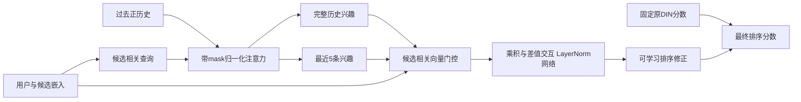

# 固定Top100、以Top20验收的网络优化结果

**结论：网络改造和实际训练已完成；收益较小，主种子Top20区间跨0。保留新网络作为实验版本，主流程继续使用原冻结DIN。**

本轮保持原双塔、原数据与同一批Top100，没有增大候选数、插入目标或增加手工历史降权。先跑四组结构实验，均未提升；随后根据验证下降现象，追加两组固定骨干的受控实验。总计六个配置，另做两个继续训练种子复核。

## 实际网络变化

- 将旧Dice的alpha注册为参数，单独验证，未发现该项带来Top20收益。
- 新增候选/用户相关的归一化注意力，分别聚合完整历史与最近5条历史。长短指事件位置，不是实际时间。
- 用向量门控融合两种兴趣，再加入用户与候选乘积、兴趣与候选乘积、绝对差值交互，通过LayerNorm/PReLU网络输出可学习修正。
- 输出头零初始化，保证开始时逐值等于原DIN。最终实验固定原骨干参数、BatchNorm状态和Dropout行为，仅训练新兴趣分支。原CTR头固定；辅助BCE为常数，不提供训练梯度。



## 全部结构实验：标准验证集

原DIN：Recall@20=0.14200408，NDCG@20=0.05807781。下表列训练更新后最佳指标，避免把回退的原检查点算成新模型收益。

| 阶段与配置 | 更新后最佳NDCG@20 | 对应Recall@20 | 是否超过原模型 |
| --- | ---: | ---: | --- |
| 首轮/v2_continued | 0.05735580 | 0.14131226 | 否 |
| 首轮/dice | 0.05741567 | 0.14140329 | 否 |
| 首轮/gated | 0.05769027 | 0.14200408 | 否 |
| 首轮/gated_copy_safe | 0.05767548 | 0.14191305 | 否 |
| 固定骨干后续/gated | 0.05810489 | 0.14218613 | 是 |
| 固定骨干后续/gated_copy_safe | 0.05810788 | 0.14218613 | 是 |

第一阶段未进入测试。后续结构仅按标准验证选择gated_copy_safe，锁定后再做种子和测试复核。

## 三个继续训练种子

全部使用相同的原DIN seed42骨干；随机性包括新增分支初始化、抽样及dropout，不等于三个独立从头训练的原模型。预定主种子仍为42。

| 种子 | 验证Recall@20 | 验证NDCG@20 | 最佳轮次，从0起 |
| --- | ---: | ---: | ---: |
| seed42 | 0.14218613 | 0.05810788 | 0 |
| seed43 | 0.14351515 | 0.05849471 | 2 |
| seed44 | 0.14205870 | 0.05815478 | 1 |

## standard/test

| 模型 | Recall@20 | NDCG@20 | Recall@100 |
| --- | ---: | ---: | ---: |
| 原DIN seed42骨干 | 0.13448230 | 0.05484047 | 0.32510937 |
| 新网络/seed42 | 0.13454859 | 0.05493697 | 0.32510937 |
| 新网络/seed43 | 0.13594061 | 0.05537984 | 0.32510937 |
| 新网络/seed44 | 0.13474745 | 0.05498619 | 0.32510937 |

预定主种子相对原DIN的NDCG@20绝对差为0.00009650，用户簇配对bootstrap 95%区间[-0.00000237, 0.00019713]。区间跨0，不能声称稳定提升。

## random/test

| 模型 | Recall@20 | NDCG@20 | Recall@100 |
| --- | ---: | ---: | ---: |
| 原DIN seed42骨干 | 0.00516378 | 0.00185575 | 0.02229757 |
| 新网络/seed42 | 0.00520733 | 0.00186779 | 0.02229757 |
| 新网络/seed43 | 0.00529443 | 0.00188566 | 0.02229757 |
| 新网络/seed44 | 0.00521977 | 0.00187185 | 0.02229757 |

预定主种子相对原DIN的NDCG@20绝对差为0.00001204，用户簇配对bootstrap 95%区间[-0.00000420, 0.00003021]。区间跨0，不能声称稳定提升。

候选完全一致，因此Recall@100保持不变。主种子标准NDCG@20相对变化约0.18%，Recall@20仅多命中5条正事件；不能将这描述成明显的推荐质量突破。三种子标准NDCG均值、随机来源结果见配套JSON。

## 检验与产物

- 全项目82项测试通过：reports/environment_logs/top20_network_tests_final.txt。
- 原双塔冻结与原DIN的310项证据文件核验通过；三个新检查点中原模型全部32个参数/缓冲张量逐值不变，新输出头实际学到了非零权重：reports/ranking_top20_integrity.json。
- 独立代码审查与后续冻结结构差异审查未发现Critical/Important问题：reports/ranking_v3_code_review.md。
- 选模/曲线/检查点/实际预测：experiments/ranking_v3_top20 和 experiments/ranking_v3_frozen_top20。
- 完整主种子四分区打分重算、全部种子产物指标与哈希核验：experiments/ranking_v3_frozen_top20/verification.json。

## 可运行入口

```powershell
. .\scripts\enter_env.ps1
python -B -m src.ranking_v3_frozen.run --phase verify
python -B -m src.ranking_v3_frozen.run --phase report
# 新目录独立复现；依赖项目中已经完成并冻结的旧DIN及首轮对照
python -B -m src.ranking_v3_frozen.run --phase fit --output-directory experiments/ranking_v3_frozen_reproduction
```

源码：src/ranking_v3/model.py 定义注意力、门控和交互分支；src/ranking_v3_frozen/model.py 定义骨干冻结；对应train.py和run.py负责实际训练、选模、复核和评测。现有Python和依赖直接复用，新增代码、缓存和权重均位于D盘。

## 结论边界

测试集已在旧阶段查看，本次属于迭代复测。Bootstrap仅反映用户抽样不确定性，不包含结构选择和继续训练随机性。当前结果支持“网络改造真实运行且得到小幅点估计收益”，不足以支持“结构稳定优于原DIN”。原DIN仍为默认主流程；实验代码保留供进一步研究。下一轮若继续，应优先改善真实时间/可共享视频属性等输入信息，并单独控制其与结构的贡献。
